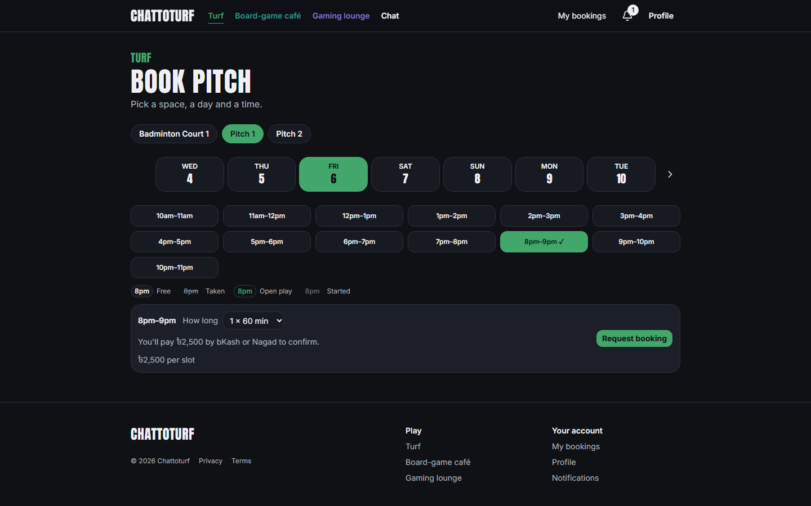
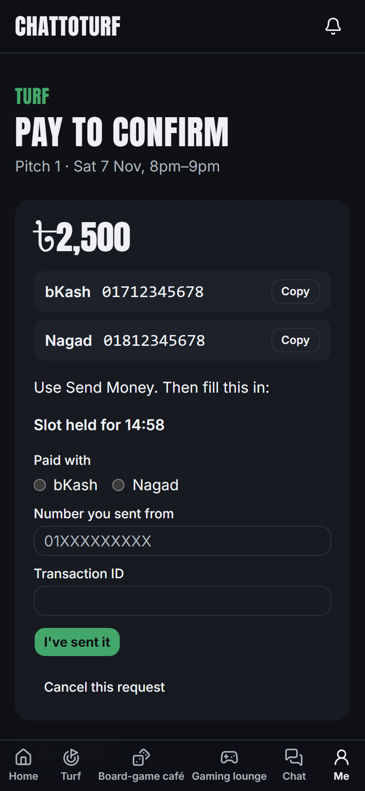
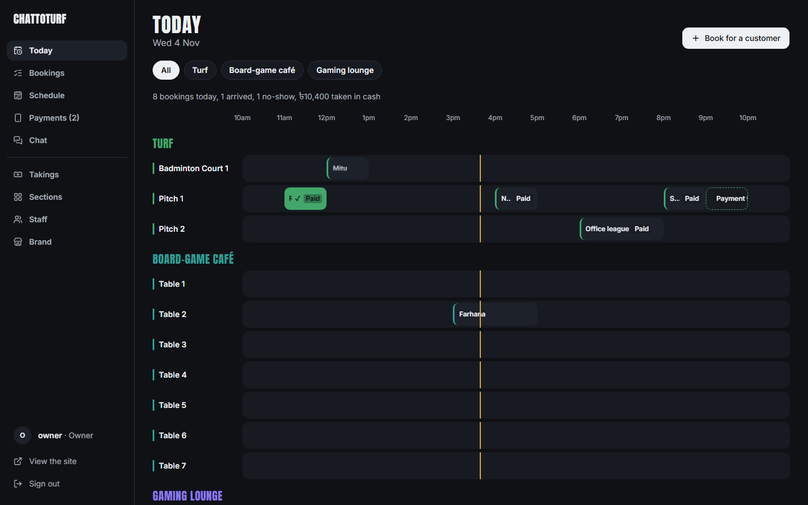
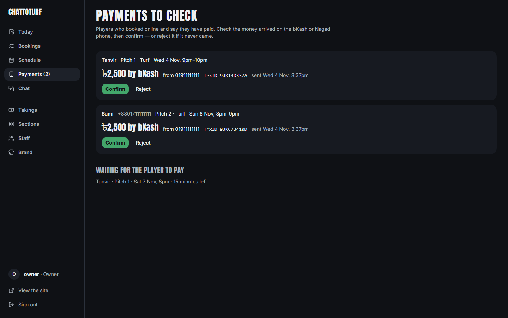
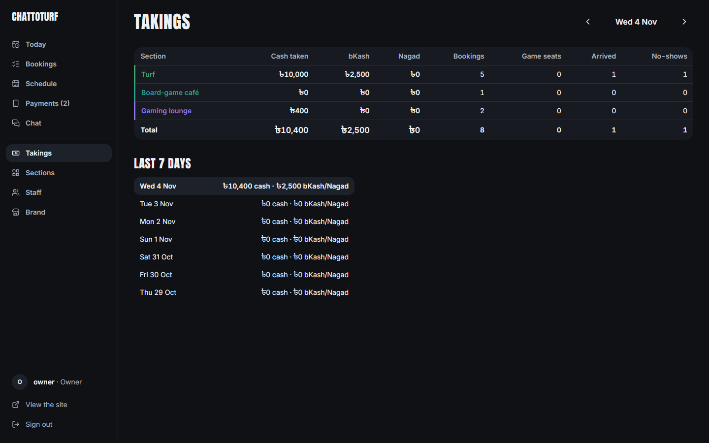
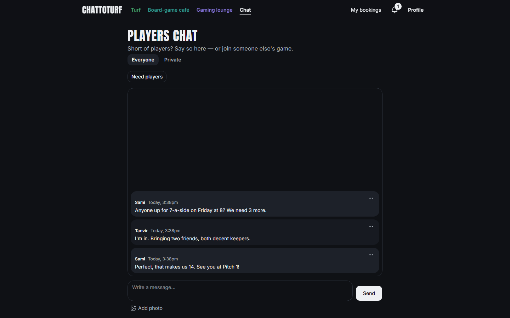
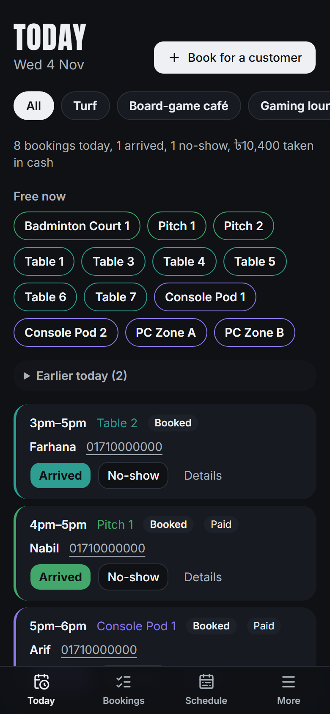

# Chattoturf: booking and matchmaking

A live booking and matchmaking website for a sports-and-games venue in Dhaka that runs a **turf**, a
**board-game café** and a **gaming lounge** under one brand. Players book a pitch, a table or a PC, pay by
bKash, join open games where a matching engine forms fair teams, and find other players in the chat. The venue's
team runs the day from one manage area: the desk, payments to check, the schedule and the takings.

**Live:** [chattoturf.vercel.app](https://chattoturf.vercel.app) · Built by Console Log Studio

### See it in action

A tour in four parts: a player books a pitch and pays by bKash; the venue checks the payment, confirms it and sees
it in Takings; a player takes the last seat in a 5-a-side game and the venue matches two teams of equal skill; and
the players chat, where a "Need players" card brings someone in, they message privately and swap numbers. The GIF
below plays twice as fast; the [full 2½-minute video (MP4)](docs/demo/chattoturf-demo.mp4) has the normal pace.

<p>
  
</p>

### Screenshots

<p>
  
</p>

| Booking a pitch | Paying by bKash (phone) |
|---|---|
|  |  |

| The desk: Today | Payments to check |
|---|---|
|  |  |

| Takings: cash, bKash, Nagad | Players chat | Today on a phone |
|---|---|---|
|  |  |  |

<sub>The video and screenshots come from a local copy of the site with made-up players, bookings and bKash numbers.</sub>

## What it does

**For players**
- Sign in with Google or an email link; a profile with a skill level per section.
- Book a space on a live slot grid (7-day strip; free, taken, open play and started at a glance).
- Priced spaces are paid by **bKash or Nagad**: the request holds the slot for 15 minutes, the player sends the
  money and types the transaction ID, and the venue confirms it. Free spaces book instantly.
- **Open play:** request a seat in a game; at the cut-off the engine forms fair groups or two balanced teams, and a
  cancelled seat is offered to the best-fitting player on the waitlist (one-time link by email).
- **Players chat:** a room to find players, private messages, photos, reporting and a bad-word filter.
- My bookings, a live notification bell and emails for every change.

**For the venue's team** (`/manage`, laptop and phone)
- **Today:** a timeline per space, Book for a customer (walk-ins), Arrived / No-show, cash taken at the desk.
- **Payments to check:** each bKash/Nagad request with the sender's number and transaction ID; Confirm or Reject.
- Bookings search, the games schedule with Match now, chat moderation.
- Owners: Takings (cash, bKash and Nagad per section and day), sections with their spaces, hours and rules, staff
  per section, and the brand (logo, address, payment numbers).

## Engineering highlights

- **The rules live in Postgres.** Booking, paying, cancelling and matching run as database functions that only the
  server can call; row-level security decides who reads what (a staff member sees only the sections they run). Every
  table reference carries the brand id, so one brand's rows can't point at another's.
- **No double bookings.** An exclusion constraint on reservations makes two bookings of the same space at the same
  time impossible, whatever the timing.
- **Money is never lost or counted twice.** Recording cash, confirming or rejecting a payment, cancelling and the
  hold running out all take turns on a per-booking lock; payments are never edited or deleted, only voided. Race
  tests fire these actions at the same moment on two database connections, and were shown to fail against a
  lock-free version.
- **Mobile money without a payment gateway.** The bKash/Nagad flow fits how small venues in Bangladesh already work
  (Send Money to the booking phone): a 15-minute hold, transaction IDs usable once, and a team check before the slot
  is booked.
- **A fair matching engine** in plain TypeScript (`packages/engine`): seeded, no I/O, property-tested with
  fast-check. It matches 500 players into tables in about 2 ms.
- **Background work without a server.** Every minute the database (`pg_cron` + `pg_net`) calls the app's job
  endpoint with a secret kept in Supabase Vault: games get matched and closed, seat offers and payment holds expire,
  and queued emails go out.
- **Realtime** chat and bell (Supabase Realtime); chat photos in a private bucket behind short-lived signed links.
- **Accessible by test:** every text/background colour pair is checked for 4.5:1 contrast; motion respects the
  system's reduced-motion setting.

## Tech stack

| | |
|---|---|
| App | Next.js 16 (App Router, Cache Components, server actions), React 19, TypeScript, Tailwind CSS 4, shadcn/ui, Zod |
| Data | Supabase: Postgres 17 with row-level security, Auth (Google + email link), Realtime, Storage, pg_cron, pg_net, Vault |
| Email | Nodemailer over Gmail SMTP, from a database outbox |
| Hosting | Vercel (app), Supabase (database), both in Seoul |
| Tests | Vitest + fast-check, pgTAP, Playwright |
| Repo | pnpm workspace: `apps/web`, `packages/engine`, `packages/sim`, `supabase/` |

## Tests

| What | Count | Command |
|---|---|---|
| Database checks (schema, security rules, permissions, every database function) | 802 in 39 files | `pnpm db:test` |
| Race tests (two database connections acting at once) | 11 | `pnpm test:race` |
| Matching engine, incl. property tests | 51 | `pnpm --filter @bm/engine test` |
| Seeded test data | 23 | `pnpm --filter @bm/sim test` |
| Web unit tests | 382 | `pnpm --filter web test` |
| Integration tests (real database, auth, Realtime, email) | 179 | `pnpm test:integration` |
| Browser tests (Playwright, laptop and phone) | 39 | `pnpm test:e2e` |

Benchmark: matching 500 players into tables takes 2.0–2.3 ms (median of 5, `packages/engine/test/bench.test.ts`).

## How it was built

Each feature started as a written design (`docs/superpowers/specs/`), was broken into a step-by-step plan
(`docs/superpowers/plans/`), and was built test-first: every bug fix began with a test that failed. Each finished
feature got a fresh whole-branch review before it was merged. The running log of decisions, fixes and open items is
in [`memory.md`](memory.md).

## Run it locally

Needs Node 24+, pnpm 12 and Docker Desktop.

```bash
pnpm install
pnpm db:start                                   # local Supabase (email goes to Mailpit at http://127.0.0.1:54324)
pnpm env:local                                  # writes apps/web/.env.local
pnpm brand:setup --name "Demo Arena" --demo     # a demo brand with three sections, players and games
pnpm --filter web dev                           # http://localhost:3000
```

Sign in at `/signin` with any email address; the link arrives in Mailpit. The demo owner is
`owner@demo-arena.test` (the team's pages are at `/manage`). Hosting, deploying, the job tick, Google sign-in and
every command are in the **[operations guide](docs/operations.md)**.
